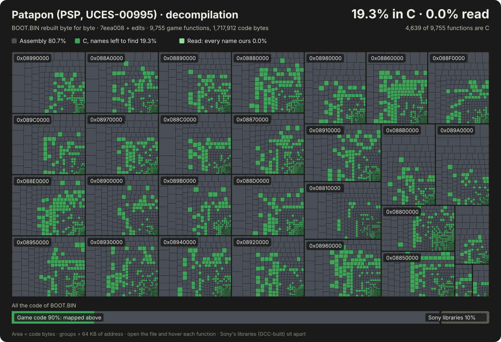

# patapon-decomp

A matching decompilation of Patapon (PlayStation Portable, SCE Japan Studio and Pyramid): C source that rebuilds the retail executable byte for byte. The target is Patapon (Europe), UCES-00995, disc 1.00 (redump 18807).

No game data is in this repository. You need an image of your own UMD.

## Status
`PSP_GAME/SYSDIR/BOOT.BIN` (plain ELF, 2,381,348 bytes, 11,068 functions) rebuilds byte for byte, part from C, the rest from disassembly. The compiler is Metrowerks CodeWarrior for PSP (mwccpsp 3.0.1, build 180 or later, `-O4,p`), measured on the game's own functions.

[](docs/progress/treemap.svg)

One rectangle per function, sized by its code bytes and grouped by 64 KB of address. Grey is still assembly, mid green is matching C whose body still uses names we did not choose (`unk_` fields, m2c locals, `D_` globals, calls to `func_`), light green is C where every name is ours. The bar under the map places the game code beside Sony's libraries (0x08820000-0x08826FFF, 0x08829000-0x0884DFFF and 0x08854000-0x08857FFF, built with another compiler). Open the map to hover each function; `docs/progress/progress.json` holds the totals and the list of C functions. `tools/progress_map.py` regenerates both after a green `make check`.

## Build
```sh
tools/setup.sh                          # pinned toolchain into tools/ and .venv/
git config core.hooksPath tools/hooks
cp /path/to/your/umd.iso disks/         # or a .cso
make check-disk                         # ids, executable format, redump match
make check                              # split, assemble, link, compare the sha1 of BOOT.BIN
```

## Matching one function
```sh
.venv/bin/python -I tools/fmatch.py asm func_089506BC          # the original
.venv/bin/python -I tools/fmatch.py m2c func_089506BC          # a first draft
.venv/bin/python -I tools/fmatch.py diff func_089506BC my.c    # MATCH, or the rows that differ
.venv/bin/python -I tools/integrate.py my.c && make split && make check
```

## Docs
- [What the community already knows](docs/community-knowledge.md)
- [Open questions](docs/mysteries.md)
- [Discoveries](docs/discoveries.md): what the code shows, with captures
