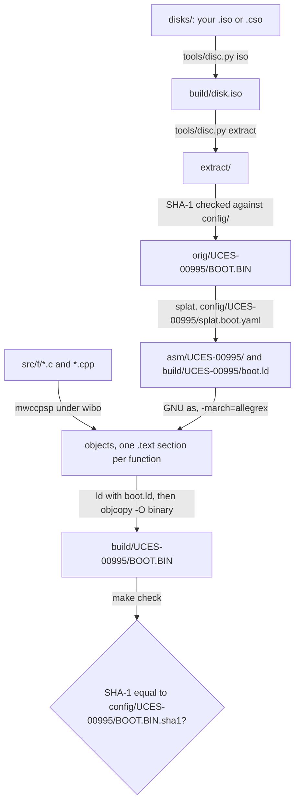

# How it works

[Back to the README](../README.md)

How the repository turns a UMD dump into a byte-identical `BOOT.BIN`, and how a function moves from assembly to C.

## Contents

- [Build pipeline](#build-pipeline)
- [Compiler](#compiler)
- [Matching a function](#matching-a-function)
- [Rules for source files](#rules-for-source-files)
- [Tools](#tools)
- [Repository checks](#repository-checks)

## Build pipeline



| Step | Command | What happens |
|---|---|---|
| Dump | `make check-disk` | A CSO is decompressed into `build/disk.iso` (an ISO is copied), every file is copied into `extract/`, and the UMD id, `PARAM.SFO` fields, executable formats and matching redump disc are printed |
| Original | `make orig` | `extract/PSP_GAME/SYSDIR/BOOT.BIN` is checked against `config/UCES-00995/BOOT.BIN.sha1` and copied to `orig/UCES-00995/` |
| Split | `make split` | splat reads the original and `config/UCES-00995/splat.boot.yaml` and writes `asm/UCES-00995/`, the linker script, the undefined symbol lists and the ELF and section header blobs |
| Build | `make` | C and C++ units are compiled, assembly is assembled, `ld` lays out the whole file at its original offsets and `objcopy` writes `BOOT.BIN` |
| Check | `make check` | Builds if needed, then compares the SHA-1 of the result with the retail one |

`make check` runs the earlier steps when they are missing or their inputs changed. The serial comes from `config/VERSION` (`UCES-00995`).

## Compiler

| Setting | Value |
|---|---|
| Compiler | Metrowerks CodeWarrior for PSP, `mwccpsp` 3.0.1, run on Linux by wibo |
| Build | 219 by default (`MWCC_VER` in the Makefile); builds 180 to 219 give the same code on every calibration function, 121 to 151 do not |
| Flags | `-c -nostdinc -Iinclude -O4,p` |
| C++ units | `-Cpp_exceptions on`, the compiler's default; their `.exceptix` tables are dropped at link time |
| Per-unit override | `MWCCFLAGS_<unit file name>` in the Makefile |

`-O4,p` is the optimisation level of the game's runtime (loop rotation with branch-likely). The linker, not the compiler, writes the `MW MIPS C Compiler (2.4.1.01)` string found in the retail `.comment` section. Sony's library code (0x08820000-0x08826FFF, 0x08829000-0x0884DFFF and 0x08854000-0x08857FFF) was built with another compiler and stays in assembly.

## Matching a function

```sh
.venv/bin/python -I tools/fmatch.py asm func_089506BC          # the original asm, labels and %hi/%lo kept
.venv/bin/python -I tools/fmatch.py m2c func_089506BC          # first-pass C from m2c
.venv/bin/python -I tools/fmatch.py decls func_089506BC        # declarations already in src/ for its symbols
.venv/bin/python -I tools/fmatch.py diff func_089506BC my.c    # compile, link at the address, compare
.venv/bin/python -I tools/integrate.py my.c && make split && make check
```

`fmatch.py diff` compiles the file with the Makefile's compiler and flags, links its `.text` at the function's address (every `func_`, `D_` and `jtbl_` symbol at the address in its name) and compares the bytes with the retail executable.

| Exit code | Meaning |
|---|---|
| 0 | `MATCH FUNC 100%` |
| 1 | The percentage and the rows side by side, differing rows marked `!!` |
| 2 | A compile error, or a C file that defines data |

Work files go to `build/fmatch/<FUNC>/`. m2c has no MIPS Metrowerks mode, so its draft is gcc-style C to start from, not an answer.

`integrate.py` checks each file with `fmatch.py diff` again, copies it to `src/f/<FUNC>.c` (or `.cpp`) and rewrites the text subsegments of `config/UCES-00995/splat.boot.yaml`: one `c` subsegment per unit, assembly chunks between them. A switch jump table that the unit compiles to `.rodata` is recorded in `config/UCES-00995/jtables.tsv`. A 100 % in isolation is necessary, not sufficient: only `make check` on the whole executable decides.

## Rules for source files

- One unit per file in `src/f/`, named after its first function. A unit may hold several contiguous functions, in address order.
- No inline assembly and no forced registers in C or C++ files. Only `include/include_asm.h` uses `__asm__`, for the `INCLUDE_ASM` macros.
- Names not yet chosen keep their generated form: `func_XXXXXXXX` for functions, `D_XXXXXXXX` for globals, `unk_` for fields. The [progress map](progress/treemap.svg) counts them.

## Tools

| Tool | Use |
|---|---|
| `tools/setup.sh` | Installs the pinned toolchain into `tools/` and `.venv/`, verified against `tools/toolchain.sha256` and `tools/requirements.lock`. Safe to re-run |
| `tools/versions.env` | Pinned versions: cross binutils, compiler kits, wibo, objdiff, m2c, decomp-permuter, asm-differ, psp-decomp-tools |
| `tools/disc.py` | Reads a UMD dump: CSO to ISO, file extraction, ids and redump match |
| `tools/fmatch.py` | Matches one function in isolation (`asm`, `m2c`, `decls`, `diff`) |
| `tools/integrate.py` | Moves matched files into `src/f/` and the splat config |
| `tools/batch_match.py` | Tries m2c drafts and their mechanical variants over functions still in assembly, writing each match for `integrate.py` |
| `tools/progress_map.py` | Writes `docs/progress/treemap.svg` and `progress.json`; refuses a build whose SHA-1 is not the original |
| `tools/compare_builds.py` | Finds each retail function in another build of the executable by masked instruction words |
| `tools/fingerprint.py` | Counts compiler fingerprints in assembly (register moves, prologue order, branch-likely rates) |

## Repository checks

Enable the hooks once per clone with `git config core.hooksPath tools/hooks`.

| Hook | Refuses |
|---|---|
| `pre-commit` | Game data or toolchain files staged, files over 1 MB, executables and disc images recognised by content, changes to protected files (target hashes, toolchain pins, Makefile, hooks), inline assembly or forced registers in C |
| `pre-push` | A push unless `make check` passes (skipped when `extract/` is missing) |

[Back to the README](../README.md)
